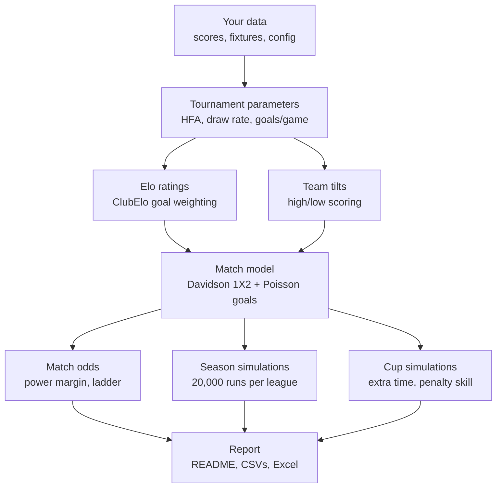

# How the model works

A plain-language walkthrough of the matchday pipeline, with the maths behind each step.
File names point to where each step lives in `soccermodel/`; settings refer to `data/japan/config.yaml`.

## The big picture

Each run goes through the steps below and rebuilds everything from scratch. Nothing carries over between
runs except a cache of lookup tables, which is only there for speed. Every run replays all matches since 2014,
so a corrected score is automatically reflected everywhere.



## Current model settings

| Setting | Value | Options |
|---|---|---|
| `elo.lambda_match` | `expected_score` | `win_prob` (original scripts) / `expected_score` |
| `prediction_params.method` | `history` | `history` / `shrink` (with `prior_matches`, default 300) |
| `prediction_params.draw_model` | `calibrated` | `league_rate` (original) / `calibrated` |
| `penalties.method` | `skill` | `coin` / `skill` |
| `margins` | 1.08 / 1.08 / 1.08 | 1X2, over/under 2.5, outrights |
| `simulation.n_sims` | 20,000 | any number; a fixed `seed` makes output reproducible |

---

## 1. Loading and checking the data (`data.py`)

- Reads `results.csv`, and treats any scores you've typed into the fixture or cup draw files as results, unless the same
  match is already in `results.csv`.
- Empty `hg_90` / `ag_90` are copied from `hg` / `ag`. They only differ when a match went to extra time.
- Every team name is checked against `initial_elo.csv`. An unknown name stops the run with a "did you mean …?" suggestion
  (standard text-similarity matching). This is what caught the `Thespakusatsu` / `ThespaKusatsu` spelling issue.

## 2. Tournament parameters (`params.py`)

For every tournament label (J1 League, Emperor Cup QF, …), from 90-minute scores:

- **Home advantage in Elo points:** `HFA = 400 · log10(home wins / away wins)`.
  If home teams win 1.5× as often as away teams, that's the result you'd expect between teams about 70 Elo points apart,
  so home advantage is worth about 70 points. Draws are ignored.
- **Draw rate** = draws ÷ matches.
- **Goals per game** = average of `hg_90 + ag_90`.

Elo updates use the all-history values (`hfa: auto`) unless the config fixes a number, for example 0 for neutral finals.

**Prices** can use these numbers in two ways (`prediction_params.method`):

- `history` (current): all seasons count equally.
- `shrink`: this season is blended with earlier ones, which count as `prior_matches` matches:

  ```
  share = (prior_matches · share_before_this_season + n · share_this_season) / (prior_matches + n)
  ```

  This is applied to the home-win, away-win and draw shares and to goals per game. Early in the season the result stays
  close to history; as matches accumulate it moves towards the current season.

  *Backtest:* season-to-date HFA turned out to be mostly noise. A light prior made predictions worse
  (50 matches: +0.18% log loss; 150: +0.03%); only a heavy prior helped, and only slightly (300: −0.01%; 600: −0.02%).
  It's left off.

  *Direct test (RMSE of the parameter itself):* for 30 league-seasons since 2019, the clock was stopped at 0–80% of the
  season, each method's estimate was compared with what the **rest** of that season produced, and errors were
  weighted by matches remaining.

  | Method | HFA RMSE (Elo pts) | Draw-rate RMSE (pts) |
  |---|---|---|
  | History (current) | 28.2 | 3.98 |
  | Season-to-date only | 56.0 | 5.92 |
  | Shrink, prior 50 / 150 / 300 / 600 | 35.0 / 30.0 / 28.5 / 28.1 | 4.35 / 4.03 / 3.96 / 3.95 |

  A full season (about 380 matches) only pins down that season's true HFA to about ±21 Elo points by chance alone.
  History's error at the start of the season is 24 points, so genuine season-to-season variation in HFA is only about
  √(24² − 21²) ≈ 12 Elo points: there is little real movement for a recency model to track. Log loss is the right metric
  for judging prices; the parameter RMSE is the sharper test for judging the estimator, and both point the same way.

Tournaments with fewer than 20 matches fall back to defaults and produce a warning.

## 3. Elo ratings (`elo.py`)

Every match since 2014 is processed in date order.

1. **Expected result for the home team:** `E = 1 / (1 + 10^(−(R_home + HFA − R_away) / 400))`.
   A 100-point edge gives E ≈ 0.64. E is an *expected score*: the home team expects to collect 64% of the points,
   with a draw worth half.
2. **Actual result:** 1 for a win, 0.5 for a draw, 0 for a loss. This uses the **final score including extra time**.
3. **Rating change:** `Δ = K · G · (actual − E)`. The home team gains Δ and the away team loses Δ, so total rating points
   stay constant. K comes from the config: 20 for early cup rounds, 30 for leagues, 40 for finals.
4. **G, the goal-margin weight (ClubElo):** a bigger win counts for more (√margin), but a favourite is expected to win
   by more, so √margin is divided by its expected value given who was favoured:

   ```
   G = √margin / E[√margin | win]        draws: G = 1 / average(home and away normalisers)
   ```

   On average G = 1, so it reshapes K by margin without inflating ratings overall.

   The expected value comes from turning the Elo gap into two Poisson goal rates whose total equals the tournament's
   goals per game. `elo.lambda_match` decides what those rates must reproduce:

   | Option | The Poisson rates must match… | 100-pt edge, 2.6 goals/game | G for 1–0 / 3–0 home win |
   |---|---|---|---|
   | `win_prob` (original) | P(win) = E | 1.86 v 0.74 goals → W/D/L 64/22/14, expected score 0.75 | 0.72 / 1.25 |
   | `expected_score` (current) | P(win) + P(draw)/2 = E | 1.60 v 1.00 goals → W/D/L 52/25/24, expected score 0.64 | 0.76 / 1.32 |

   The original version reads E as a pure win probability and then fits it with a model that also produces draws, so it
   counts draws twice and treats favourites as stronger than Elo says. *Effect:* ratings move about 1 point on average
   (10 at most). Backtest −0.005% log loss: tiny, but it's the consistent version.

   These normalisers are precomputed for every 10 Elo points and for goals-per-game levels from 2.0 to 3.5, then cached.

> **The Poisson model, used throughout.** Each team's goals follow a Poisson distribution with an expected value λ.
> For example, λ = 1.5 gives about a 22% chance of 0 goals, 33% of 1 and 25% of 2. The two teams' goals are treated as
> independent, so the two λs give the probability of every scoreline, and from that win, draw, over 2.5, and so on.

## 4. Team tilts (`goals.py`)

A tilt measures whether a team's matches tend to have more goals (> 1) or fewer (< 1) than their tournament's average.
After each match, for each team:

```
new tilt = 0.98 · old tilt + 0.02 · (match goals / opponent's tilt / tournament goals per game)
```

- The 0.98/0.02 split means the tilt is a slowly fading average, with a memory of roughly the last 50 matches.
- Dividing by the opponent's tilt stops a team being labelled "high-scoring" just because it kept meeting high-scoring opponents.
- Each match is measured against its own tournament's goals per game, using 90-minute scores.

## 5. Match probabilities and expected goals (`poisson.py`, `goals.py`, `pipeline.py`)

For a fixture, the model takes the Elo difference plus home advantage, d.

**1X2 probabilities: the Elo-Davidson model.** Plain Elo has no concept of a draw; Davidson adds one with a draw parameter ν:

```
θ = 10^(d/400)
P(home) = θ / (θ + 1 + ν√θ)     P(draw) = ν√θ / (…)     P(away) = 1 / (…)
P(draw | level teams) = ν / (2 + ν)
```

The draw probability is highest for level teams and shrinks as the gap grows.

**Draw calibration** (`prediction_params.draw_model`):

- `league_rate` (original) sets ν so that P(draw | level teams) equals the league's overall draw rate. But that overall rate
  is an average over real matchups, most of them uneven, and the model can only give *fewer* draws than the level-teams
  value for any uneven match. So its average draw rate across the league must come out below the observed rate.
  For small gaps `P(draw | d) ≈ P(draw | 0) · (1 − c·d²)`, so the shortfall grows with the **spread** of Elo gaps:
  about 1–1.5 points in Japan, which is where the familiar "+1.5% on the draw" rule of thumb comes from.
- `calibrated` (current) chooses ν so that the **average** predicted draw probability over the league's actual past
  matchups equals the observed draw rate (moment matching). For Davidson this gives the same value as fitting ν by
  maximum likelihood. It's refitted for each league on every run.

| League | League draw rate | Calibrated level-teams rate | Implied bump | Spread of Elo gaps (sd) |
|---|---|---|---|---|
| J1 | 0.249 | 0.260 | +1.1 | 117 |
| J2 | 0.276 | 0.285 | +0.9 | 104 |
| J3 | 0.244 | 0.253 | +0.9 | 103 |
| JFL | 0.248 | 0.262 | +1.4 | 140 |

*Walk-forward backtest* (refit at each season start on earlier matches only; 9,631 league matches since 2019; actual draws 26.0%):

| Draw model | Log loss vs original | Predicted draws |
|---|---|---|
| League rate (original) | — | 24.4% |
| League rate + 0.015 | −0.069% | 25.9% |
| **Calibrated per league** | **−0.073%** | 25.5% |
| Calibrated on the last 3 years only | −0.033% | 25.7% |

Cups keep fixed values from the config (`predict: {hfa, draw_rate, total_goals}`).

**Expected goals.** For each Elo difference, the model finds Poisson goal rates that give the same home-win probability
as Davidson and add up to the league's goals per game. This is stored as a share, "home gets X% of the goals",
for every 5 Elo points: the lambda lookup table. For a real match:

```
total = goals per game × home tilt × away tilt
expg1 = total × home share        expg2 = total × (1 − home share)
```

**Over/under 2.5.** The sum of two Poisson goal counts is Poisson with rate `expg1 + expg2`, so
`P(over 2.5) = 1 − P(0, 1 or 2 total goals)`.

## 6. Turning probabilities into odds (`odds.py`)

- **Power-method margin:** `odds = (1/p)^k` with `k = log(n / margin) / log(n)`, where n is the number of outcomes.
  Raising to a power slightly below 1 shortens longshots relatively more than favourites, which is how real books
  distribute margin. With n = 3 and margin 1.08, k ≈ 0.930.
- **Ladder rounding:** each price snaps to the nearest price on the ladder (…, 3.6, 3.75, 3.8, …), so the final overround
  is close to, not exactly, the target. Outright markets are priced as Yes/No pairs with n = 2.

## 7. Season simulation (`league.py`)

1. **Current table** from this season's results: points, then goal difference, then goals scored.
2. **Each remaining fixture is simulated 20,000 times:** the outcome is drawn with the (calibrated) Davidson probabilities,
   then a scoreline is drawn from the Poisson distribution restricted to that outcome. The 1X2 split therefore matches
   the published odds exactly, while goal difference behaves realistically.
3. Teams are ranked in each simulated season by points, goal difference, goals scored, then a random tiebreak.
4. **Markets:** "Top 3" = share of simulated seasons finishing 1st–3rd, and so on, priced as Yes/No.

Ratings stay fixed during a simulated season.

## 8. Cup simulation (`cup.py`)

Each of the 20,000 runs plays out the rest of the bracket:

- **Known ties** come from the draw file. Played legs use the real scores; `W:QF-2` means "winner of QF tie 2".
- **Ties not drawn yet** are drawn at random from the surviving teams, separately in each simulation.
- **Two-legged ties** add up goals across both legs.
- **A level tie** goes to extra time, simulated as Poisson with a third of each side's expected goals (30 of 90 minutes),
  then penalties.
- **Penalties** (`penalties.method: skill`): each side takes five kicks at its own conversion rate from
  `data/japan/penalties.csv`, followed by sudden death. The win probability is calculated exactly for each pair of teams:

  ```
  P(A wins) = P(A scores more in 5) + P(level after 5) · pA(1−pB) / (pA(1−pB) + pB(1−pA))
  ```

  Rates come from the `skill` column (your adjusted values). Teams without one are shrunk towards the file average
  (`prior_kicks`), and teams not in the file use `default_skill` (0.75). With `coin`, every shoot-out is 50/50.
  *Effect today:* cup winner chances move by up to about 0.9 points, close to simulation noise (±0.3 points for a 30% chance).
  It can't be backtested, because `results.csv` doesn't record shoot-outs.
- Finals marked `neutral` have no home advantage.

---

## Known limitations and ideas

| Topic | Status |
|---|---|
| Draws fall away with the Elo gap faster than Davidson allows (27.9% actual v 26.7% model for gaps under 50; 23.2% v 25.6% at 100–150) | Idea: a second "draw decay" parameter fitted by maximum likelihood |
| Ratings fixed within simulations (a team doesn't get stronger after winning simulated games) | Accepted for now |
| Elo uses the score after extra time; tilts and parameters use 90-minute scores | Intentional |
| Recency-weighted HFA/draw rate | Built (`shrink`), off: no gain in log loss or in parameter RMSE; true HFA varies only about ±12 Elo between seasons |
| Shoot-out results not stored | Adding a `winner` to results would allow backtesting penalty skill |
