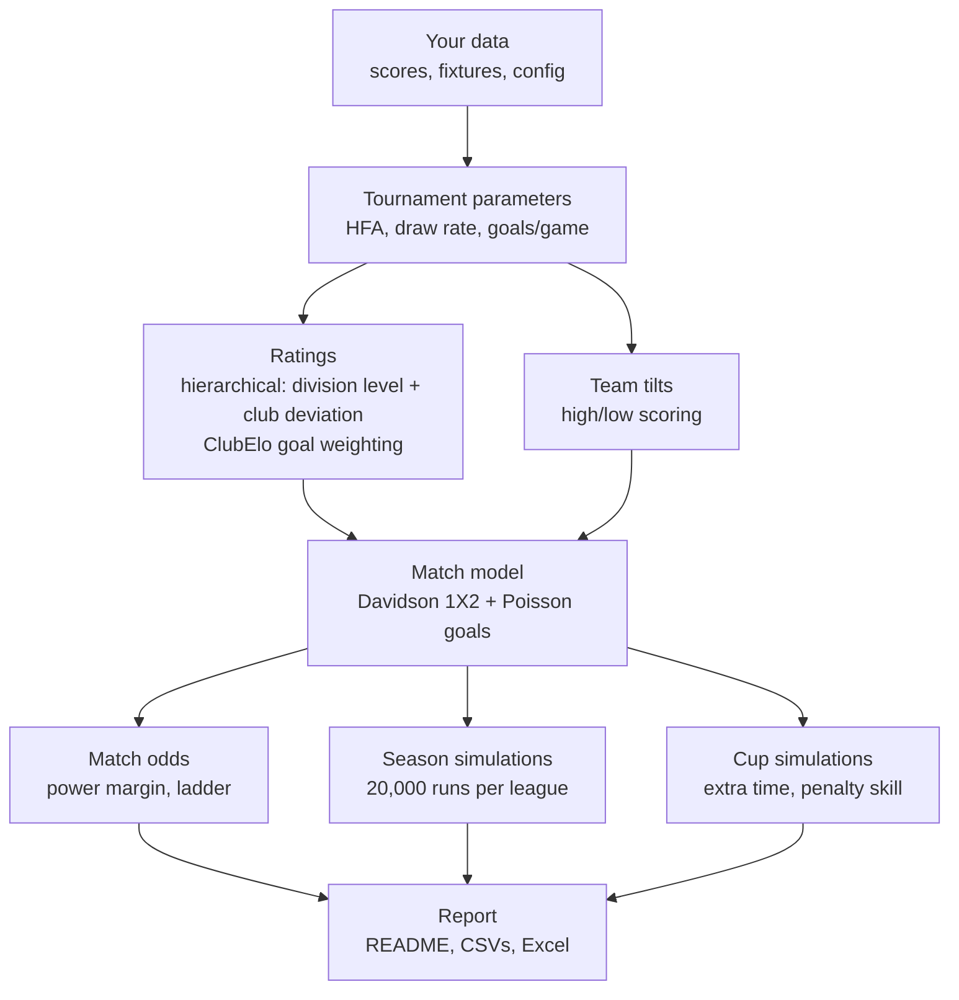

# How the model works

A plain-language walkthrough of the matchday pipeline, with the maths behind each step.
File names point to where each step lives in `soccermodel/`; settings refer to `data/japan/config.yaml`.

## The big picture

Each run goes through the steps below and rebuilds everything from scratch. Nothing carries over between
runs except a cache of lookup tables, which is only there for speed. Every run replays all matches since 2014,
so a corrected score is automatically reflected everywhere.



## Current model settings

| Setting | Value | Options |
|---|---|---|
| `elo.engine` | `hierarchical` (since 2026-10-28) | `elo` (plain Elo) / `hierarchical` (step 3b) |
| `elo.lambda_match` | `expected_score` | `win_prob` (original scripts) / `expected_score` |
| `prediction_params.method` | `history` | `history` / `shrink` (with `prior_matches`, default 300) |
| `prediction_params.draw_model` | `calibrated` | `league_rate` (original) / `calibrated` |
| `cup_params.method` | `anchored` | `first_round` (original) / `anchored` (with `anchor`, `anchor_matches` 300) |
| `penalties.method` | `skill` | `coin` / `skill` |
| `margins` | 1.08 / 1.08 / 1.08 | 1X2, over/under 2.5, outrights |
| `simulation.n_sims` | 20,000 | any number; a fixed `seed` makes output reproducible |

The engine is shared with the Greek model (soccer-model-gr), which added the options below. With all of them off the
outputs are what the original Japan engine gave (checked: every output CSV byte-for-byte identical). Japan uses the
hierarchical rating engine since 2026-10-28; the others need a Japan backtest before they are switched on
(soccer-model-gr's docs/PIPELINE.md has the Greek tests; `tools/backtest.py japan scale|stakes` there found the scale
best at 400 and no stakes effect in Japan).

| Setting | Japan | What it does |
|---|---|---|
| `elo.engine` | `hierarchical` (since 2026-10-28) | `elo` (plain Elo, step 3) / `hierarchical`: division level + club deviation (settings under `hierarchical:`; step 3b, fit below) |
| `prediction_params.hfa_halflife` | off | `{league: half-life}`: price HFA from recency-weighted matches (Japan: tested neutral, HFA moves only about ±12 Elo) |
| `prediction_params.scale` | off (400) | `{league: Davidson scale}`: steeper or flatter prices for the same ratings, HFA kept |
| `tournaments.<league>.season_boost` | off | K × k_mult for each club's first part of its season |
| `leagues.<league>.stakes` | off | price shift against sides with nothing left to play for |
| `leagues.<league>.phases` / `final_groups`, cup `league_phase` / `ties` | not used | split-table phases with carried points, grouped leagues, league-phase cups |
| `python -m soccermodel shadow` | not run | price a matchday with the other engine and log both (`--engine elo`) |

**Hierarchical rating for Japan** (fitted in soccer-model-gr, `tools/hierarchical.py japan --top-plain all
--away-summers --away-cap`). A club's rating is its division's level plus its own deviation; league matches move only
the deviations (re-centred within the division), matches between divisions also move the levels, and J1 stays on the
plain Elo update. The spring 2026 season is mapped with `tiers`: the J1 group is J1, and the J2/J3 group's clubs belong
to the division they play in 2026-27 (`next`). Fitted before each season from 2021 to 2026-27 (rolling origins) and
scored on that season against the live Elo on the same matches:

| Check | Elo | Hierarchical |
|---|---|---|
| League log loss, 2022 to 2026-27: all / J1 / J2 / J3 / JFL | – | −0.09% (±0.07) / +0.08% / −0.15% / +0.04% / −0.41% (±0.23) |
| Cup log loss (888 matches) | – | **−1.34%** (±0.63) |
| Cup residual of the higher division: J1 v J2 / J1 v J3 / J2 v J3 / J3 v JFL | +0.013 / −0.016 / −0.163 / −0.301 | +0.036 / +0.041 / −0.110 / −0.249 |
| Promoted into J3, first 10 matches (residual; + = rated too low) | +0.108 | +0.052 |
| Lag: residual of matches 1–5 predicts 6–10 (slope) | +0.03 | +0.01 |

Japan's fitted values differ from Greece's, as they should: much less movement in the lower divisions (summer sd 37–53
v 136, drift 6–9 per match v 22), no relegation drop, and promoted clubs +15 to +34. Placing the divisions is mixed: J2
and JFL sides are placed better against the division above in cups, J1 sides now look a little too low against J2/J3
(about 25 Elo, under one standard error), and the JFL level sits about 100 above live Elo (J3 sides were overrated
against JFL in cups by both engines, 13 ties). Largest early moves are new clubs (J-Lease FC, university sides in the
Emperor's Cup), which start with the uncertainty of an unknown club: J-Lease FC, out of the Regional League with only
two Emperor's Cup matches in the data, sat at 728 on Elo against about 1,060 here, much closer to its JFL form.
Switched on 2026-10-28; the shadow run was dropped. The J1 level is learnt from cups and play-offs only, where J1 sides
may rotate: it doesn't affect league prices (a league match only sees the two clubs' deviations), only cups and clubs
changing division.

---

## 1. Loading and checking the data (`data.py`)

- Reads `results.csv`, and treats any scores you've typed into the fixture or cup draw files as results, unless the same
  match is already in `results.csv`.
- Empty `hg_90` / `ag_90` are copied from `hg` / `ag`. They only differ when a match went to extra time.
- Every team name is checked against `initial_elo.csv`. An unknown name stops the run with a "did you mean …?" suggestion
  (standard text-similarity matching).

## 2. Tournament parameters (`params.py`)

For every tournament label (J1 League, Emperor Cup QF, …), from 90-minute scores:

- **Home advantage in Elo points:** `HFA = 400 · log10(home wins / away wins)`.
  If home teams win 1.5× as often as away teams, that's the result you'd expect between teams about 70 Elo points apart,
  so home advantage is worth about 70 points. Draws are ignored.
- **Draw rate** = draws ÷ matches.
- **Goals per game** = average of `hg_90 + ag_90`.

Elo updates use the all-history values (`hfa: auto`) unless the config fixes a number, for example 0 for neutral finals.

**Prices** can use these numbers in two ways (`prediction_params.method`):

- `history` (current): all seasons count equally.
- `shrink`: this season is blended with earlier ones, which count as `prior_matches` matches:

  ```
  share = (prior_matches · share_before_this_season + n · share_this_season) / (prior_matches + n)
  ```

  This is applied to the home-win, away-win and draw shares and to goals per game. Early in the season the result stays
  close to history; as matches accumulate it moves towards the current season.

  *Backtest:* season-to-date HFA turned out to be mostly noise. A light prior made predictions worse
  (50 matches: +0.18% log loss; 150: +0.03%); only a heavy prior helped, and only slightly (300: −0.01%; 600: −0.02%).
  It's left off.

  *Direct test (RMSE of the parameter itself):* for 30 league-seasons since 2019, the clock was stopped at 0–80% of the
  season, each method's estimate was compared with what the **rest** of that season produced, and errors were
  weighted by matches remaining.

  | Method | HFA RMSE (Elo pts) | Draw-rate RMSE (pts) |
  |---|---|---|
  | History (current) | 28.2 | 3.98 |
  | Season-to-date only | 56.0 | 5.92 |
  | Shrink, prior 50 / 150 / 300 / 600 | 35.0 / 30.0 / 28.5 / 28.1 | 4.35 / 4.03 / 3.96 / 3.95 |

  A full season (about 380 matches) only pins down that season's true HFA to about ±21 Elo points by chance alone.
  History's error at the start of the season is 24 points, so genuine season-to-season variation in HFA is only about
  √(24² − 21²) ≈ 12 Elo points: there is little real movement for a recency model to track. Log loss is the right metric
  for judging prices; the parameter RMSE is the sharper test for judging the estimator, and both point the same way.

Tournaments with fewer than 20 matches fall back to defaults and produce a warning.

## 3. Ratings (`elo.py`, `hierarchical.py`)

Every match since 2014 is processed in date order. Two engines share the same inputs (expected score, K, HFA and the
ClubElo goal weight G below) and produce the same outputs (current ratings plus each match's pre-match ratings).
`elo.engine` picks one: `hierarchical` is live; `elo`, the plain update described first, is what it builds on.

### 3a. Plain Elo (`elo.engine: elo`)

1. **Expected result for the home team:** `E = 1 / (1 + 10^(−(R_home + HFA − R_away) / 400))`.
   A 100-point edge gives E ≈ 0.64. E is an *expected score*: the home team expects to collect 64% of the points,
   with a draw worth half.
2. **Actual result:** 1 for a win, 0.5 for a draw, 0 for a loss. This uses the **final score including extra time**.
3. **Rating change:** `Δ = K · G · (actual − E)`. The home team gains Δ and the away team loses Δ, so total rating points
   stay constant. K comes from the config: 20 for early cup rounds, 30 for leagues, 40 for finals.
4. **G, the goal-margin weight (ClubElo):** a bigger win counts for more (√margin), but a favourite is expected to win
   by more, so √margin is divided by its expected value given who was favoured:

   ```
   G = √margin / E[√margin | win]        draws: G = 1 / average(home and away normalisers)
   ```

   On average G = 1, so it reshapes K by margin without inflating ratings overall.

   The expected value comes from turning the Elo gap into two Poisson goal rates whose total equals the tournament's
   goals per game. `elo.lambda_match` decides what those rates must reproduce:

   | Option | The Poisson rates must match… | 100-pt edge, 2.6 goals/game | G for 1–0 / 3–0 home win |
   |---|---|---|---|
   | `win_prob` (original) | P(win) = E | 1.86 v 0.74 goals → W/D/L 64/22/14, expected score 0.75 | 0.72 / 1.25 |
   | `expected_score` (current) | P(win) + P(draw)/2 = E | 1.60 v 1.00 goals → W/D/L 52/25/24, expected score 0.64 | 0.76 / 1.32 |

   The original version reads E as a pure win probability and then fits it with a model that also produces draws, so it
   counts draws twice and treats favourites as stronger than Elo says. *Effect:* ratings move about 1 point on average
   (10 at most). Backtest −0.005% log loss: tiny, but it's the consistent version.

   These normalisers are precomputed for every 10 Elo points and for goals-per-game levels from 2.0 to 3.5, then cached.

### 3b. Hierarchical engine (`elo.engine: hierarchical`, live)

A club's rating is **its division's level + its own deviation**, and each carries an uncertainty (a variance). The
update is the simplified Kalman filter of Szczecinski & Tihon (2023), with the same E, K, HFA and G as plain Elo:

```
E   = 1 / (1 + 10^(−d / 400)),  d = R_home − R_away + HFA        I = E(1 − E) / c²,  c = 400 / ln 10
w   = K / default_K
innovation = w · G · (actual − E) / c / (1 + w · (u_home + u_away + P_home + P_away) · I)
deviation  += u · innovation                (away side mirrored)
u          ← u · (1 − w · u · I / den) + q²  (q = drift per match)
```

u is a club's variance and P a division level's. A club whose rating is uncertain (new, promoted, back after time
away) moves a lot; a settled club moves little. In words:

- **League match** (both clubs in one division): only the two deviations move, and the division's deviations are
  re-centred to mean zero after every match, so a division can't inflate or deflate on its own results.
- **Match between divisions** (cups, play-offs): the two division levels move as well, by their variance P. This is
  how the model learns how far apart J1, J2, J3 and JFL are.
- **J1 on plain Elo** (`plain_top: true`): J1 clubs move by exactly `K · G · (actual − E)` and add nothing to the
  denominator, so a J1 league match is the plain Elo update of step 3a. The J1 *level* is learnt only from cups and
  play-offs, so it affects cup prices and clubs changing division, never J1 league prices.
- **Clubs outside the leagues** (cup-only sides) keep a plain rating with their own variance.

**Season start.** A club keeps its rating, shrinks by `rho` (0.1) towards its old division's level and gains the summer
variance (`s_low` 36.6). Promoted clubs gain `up` (15) per division climbed, relegated clubs lose `down` (0.3) per
division dropped, plus `move` variance. Each division's level becomes the mean rating of its new members. A new club
starts at `initial_elo + new` with sd `new_sd` (229): an unknown club can move fast. With `away_summers` a club
returning after seasons without a match gets the summer variance once per season away, capped (`away_cap`) at a new
club's.

**Divisions** come from `hierarchical.tiers` (tournament → tier). A club's division in a season is the league it played
most in; for the current season the fixture files count too, so clubs that haven't played yet are placed. The spring
2026 transition season uses `next`: clubs of the J2/J3 100 Year Vision group belong to the division they play in
2026-27.

All `hierarchical.params` are maximum-likelihood fits from soccer-model-gr (values and backtest at the top of this
page). They are not refitted on each run.

> **The Poisson model, used throughout.** Each team's goals follow a Poisson distribution with an expected value λ.
> For example, λ = 1.5 gives about a 22% chance of 0 goals, 33% of 1 and 25% of 2. The two teams' goals are treated as
> independent, so the two λs give the probability of every scoreline, and from that win, draw, over 2.5, and so on.

## 4. Team tilts (`goals.py`)

A tilt measures whether a team's matches tend to have more goals (> 1) or fewer (< 1) than their tournament's average.
After each match, for each team:

```
new tilt = 0.98 · old tilt + 0.02 · (match goals / opponent's tilt / tournament goals per game)
```

- The 0.98/0.02 split means the tilt is a slowly fading average, with a memory of roughly the last 50 matches.
- Dividing by the opponent's tilt stops a team being labelled "high-scoring" just because it kept meeting high-scoring opponents.
- Each match is measured against its own tournament's goals per game, using 90-minute scores.

## 5. Match probabilities and expected goals (`poisson.py`, `goals.py`, `pipeline.py`)

For a fixture, the model takes the rating difference plus home advantage, d.

**1X2 probabilities: the Elo-Davidson model.** Plain Elo has no concept of a draw; Davidson adds one with a draw parameter ν:

```
θ = 10^(d/400)
P(home) = θ / (θ + 1 + ν√θ)     P(draw) = ν√θ / (…)     P(away) = 1 / (…)
P(draw | level teams) = ν / (2 + ν)
```

The draw probability is highest for level teams and shrinks as the gap grows.

**Draw calibration** (`prediction_params.draw_model`):

- `league_rate` (original) sets ν so that P(draw | level teams) equals the league's overall draw rate. But that overall rate
  is an average over real matchups, most of them uneven, and the model can only give *fewer* draws than the level-teams
  value for any uneven match. So its average draw rate across the league must come out below the observed rate.
  For small gaps `P(draw | d) ≈ P(draw | 0) · (1 − c·d²)`, so the shortfall grows with the **spread** of Elo gaps:
  about 1–1.5 points in Japan, which is where the empirical "+1.5% on the draw" rule of thumb comes from.
- `calibrated` (current) chooses ν so that the **average** predicted draw probability over the league's actual past
  matchups equals the observed draw rate (moment matching). For Davidson this gives the same value as fitting ν by
  maximum likelihood. It's refitted for each league on every run.

| League | League draw rate | Calibrated level-teams rate | Implied bump | Spread of rating gaps (sd) |
|---|---|---|---|---|
| J1 | 0.250 | 0.259 | +0.9 | 112 |
| J2 | 0.277 | 0.285 | +0.8 | 102 |
| J3 | 0.243 | 0.251 | +0.8 | 99 |
| JFL | 0.249 | 0.263 | +1.4 | 143 |

Values from the run of 2026-10-28, on the hierarchical ratings; the report shows the current ones for each league.

*Walk-forward backtest* (plain Elo ratings; refit at each season start on earlier matches only; 9,631 league matches
since 2019; actual draws 26.0%):

| Draw model | Log loss vs original | Predicted draws |
|---|---|---|
| League rate (original) | — | 24.4% |
| League rate + 0.015 | −0.069% | 25.9% |
| **Calibrated per league** | **−0.073%** | 25.5% |
| Calibrated on the last 3 years only | −0.033% | 25.7% |

Cups have their own parameters; see step 8.

**Expected goals.** For each Elo difference, the model finds Poisson goal rates that give the same home-win probability
as Davidson and add up to the league's goals per game. This is stored as a share, "home gets X% of the goals",
for every 5 Elo points: the lambda lookup table. For a real match:

```
total = goals per game × home tilt × away tilt
expg1 = total × home share        expg2 = total × (1 − home share)
```

**Over/under 2.5.** The sum of two Poisson goal counts is Poisson with rate `expg1 + expg2`, so
`P(over 2.5) = 1 − P(0, 1 or 2 total goals)`.

## 6. Turning probabilities into odds (`odds.py`)

- **Power-method margin:** `odds = (1/p)^k` with `k = log(n / margin) / log(n)`, where n is the number of outcomes.
  Raising to a power slightly below 1 shortens longshots relatively more than favourites, which is how real books
  distribute margin. With n = 3 and margin 1.08, k ≈ 0.930.
- **Ladder rounding:** each price snaps to the nearest price on the ladder (…, 3.6, 3.75, 3.8, …), so the final overround
  is close to, not exactly, the target. Outright markets are priced as Yes/No pairs with n = 2.

## 7. Season simulation (`league.py`)

1. **Current table** from this season's results: points, then goal difference, then goals scored.
2. **Each remaining fixture is simulated 20,000 times:** the outcome is drawn with the (calibrated) Davidson probabilities,
   then a scoreline is drawn from the Poisson distribution restricted to that outcome. The 1X2 split therefore matches
   the published odds exactly, while goal difference behaves realistically.
3. Teams are ranked in each simulated season by points, goal difference, goals scored, then a random tiebreak.
4. **Markets:** "Top 3" = share of simulated seasons finishing 1st–3rd, and so on, priced as Yes/No.

Ratings stay fixed during a simulated season.

## 8. Cup simulation (`cup.py`, `params.py`)

### Cup parameters (`cup_params`)

Cup matches are priced with the same Davidson + Poisson model as league matches (step 5), but with their own HFA,
level-teams draw rate and goals per game.

**Why not the simple league formula?** `400 · log10(home wins / away wins)` only measures home advantage when home and
away sides are equally strong on average, which holds in a balanced league schedule. In cups it doesn't:

| Group | Matches | Raw HFA | Rating-adjusted HFA | Avg home − away rating |
|---|---|---|---|---|
| Emperor's Cup early rounds | 968 | 161 | 23 | +187 (pro clubs hosting amateurs) |
| Emperor's Cup late rounds | 102 | 76 | 60 | +26 |
| League Cup early rounds | 575 | 11 | 50 | −39 (lower-division clubs hosting) |
| League Cup late rounds | 192 | 94 | 100 | 0 |
| J1+J2+J3 (anchor) | 13,176 | 31 | 32 | +1 |

Adjusted with the live hierarchical ratings (2026-10-28). On plain Elo the early-round fits were 8 (Emperor's Cup) and
61 (League Cup): the hierarchical engine places lower-division and amateur sides closer to the clubs hosting them, so
less of the early-round home record is explained by strength.

The raw ratio mixes up "the home side is stronger" with "playing at home helps". For leagues the two methods agree;
for cups they can be far apart, in either direction.

**`anchored` method (current):**

1. **Split into early and late rounds,** listed per cup in the config:
   - Emperor's Cup: early = `Emperor Cup`; late = `Emperor Cup R16`, `QF`, `SF`.
   - League Cup: early = `League Cup`; late = `League Cup PO`, `QF`, `SF`.
   - Finals are excluded from the fit and priced with the late values and HFA 0 (neutral venue).
2. **Rating-adjusted fit:** HFA and the level-teams draw rate are estimated by maximum likelihood with the Davidson
   model, using each match's pre-match rating gap from the live engine (refitted every run). This separates home advantage from team strength. Goals per game is the raw average.
3. **Anchor:** each group is blended with the J1+J2+J3 league fit, which counts as `anchor_matches` (300) matches:

   ```
   value = (n_group · group_value + 300 · anchor_value) / (n_group + 300)
   ```

   Small groups, like the Emperor's Cup late rounds (102 matches), lean mostly on the anchor; large groups mostly on their own data.
4. **Priced round by round:** each round uses the parameters of the phase its tournament label belongs to.

Current values (late rounds; all remaining rounds this season are late):

| Cup | HFA | Level-teams draw | Goals/game |
|---|---|---|---|
| Emperor's Cup | 39.5 | 0.262 | 2.55 |
| League Cup | 58.7 | 0.267 | 2.67 |

A cup's `predict: {hfa, draw_rate, total_goals}` in the config still overrides any of these. The full fits, raw and
adjusted, are written to `output/japan/cup_params.csv` on every run.

For the **rating updates**, the Emperor's Cup early rounds use a fixed HFA 10 (the venue effect fitted on plain Elo
ratings when it was set); other cup labels use `hfa: auto`. On the hierarchical ratings the same fit now gives about 23;
see "Known limitations and ideas".

### The bracket

Each of the 20,000 runs plays out the rest of the bracket:

- **Known ties** come from the draw file (`round,tie,leg,…`). `tie` numbers the pairings within a round (1, 2, 3, …);
  `leg` is 1, or 2 for the return match with home and away swapped. Played legs use the real scores; `W:QF-2` means
  "winner of QF tie 2", which lets the draw file lay out a fixed bracket.
- **Seeded entrants:** a round can list teams that join the competition there. For example, the League Cup QF has
  `entrants: [Machida Zelvia, Kashiwa Reysol, Kashima Antlers, Vissel Kobe]`, the seeded AFC clubs, who meet the 4 PO winners.
- **Ties not drawn yet** are drawn at random from the teams in that round, separately in each simulation.
- **Bracket check:** the run counts teams through every round, including entrants, and warns if a round has an odd
  number of teams or the bracket doesn't end with one winner.
- **Two-legged ties** add up goals across both legs.
- **A level tie** goes to extra time, simulated as Poisson with a third of each side's expected goals (30 of 90 minutes),
  then penalties.
- **Penalties** (`penalties.method: skill`): each side takes five kicks at its own conversion rate from
  `data/japan/penalties.csv`, followed by sudden death. The win probability is calculated exactly for each pair of teams:

  ```
  P(A wins) = P(A scores more in 5) + P(level after 5) · pA(1−pB) / (pA(1−pB) + pB(1−pA))
  ```

  Rates come from the `skill` column. Teams without one are shrunk towards the file average
  (`prior_kicks`), and teams not in the file use `default_skill` (0.77). With `coin`, every shoot-out is 50/50.
- Finals marked `neutral` have no home advantage.

## 9. Report (`report.py`, `pipeline.py`)

Everything lands in `output/japan/`:

- `README.md`: per league the pricing parameters, the next matches, the table with projection and the outright prices;
  per cup the next ties and outrights. "Next matches" covers 6 days from the first fixture after the latest result,
  plus any overdue fixture still without a score (a postponed match stays listed until its score is entered).
- `report.xlsx`: the same tables in one workbook.
- `ratings.csv` (rating, tilt, last match), `tournament_params.csv`, `cup_params.csv` (raw and adjusted cup fits) and,
  per competition, `table.csv`, `predictions.csv`, `positions.csv`, `outrights.csv`.

Warnings (small tournaments, bracket problems) appear at the top of the report.

---

## Known limitations and ideas

| Topic | Status |
|---|---|
| Draws fall away with the Elo gap faster than Davidson allows (27.9% actual v 26.7% model for gaps under 50; 23.2% v 25.6% at 100–150) | Idea: a second "draw decay" parameter fitted by maximum likelihood |
| Ratings fixed within simulations (a team doesn't get stronger after winning simulated games) | Accepted for now |
| Ratings use the score after extra time; tilts and parameters use 90-minute scores | Intentional |
| Recency-weighted HFA/draw rate | Built (`shrink`), off: no gain in log loss or in parameter RMSE; true HFA varies only about ±12 Elo between seasons |
| Emperor's Cup early rounds: rating-update HFA | Set to 10 (Elo-adjusted venue effect) instead of the raw ~161, which mostly reflected pro clubs hosting. Walk-forward backtest on plain Elo: league matches −0.02% log loss (±0.01); early cup rounds +0.11% (±0.09). J1 ratings rose about 10–13 points. On the hierarchical ratings the adjusted fit is about 23: worth re-testing before changing. |
| Higher-tier clubs underperform in early cup rounds (Emperor's Cup J1 clubs: 0.816 actual v 0.868 expected; likely rotation and priorities) | Ideas: a fitted "favourite discount" for early-round cup pricing; lower K for early cup rounds |
| Shoot-out results not stored | Adding a `winner` to results would allow backtesting penalty skill |
